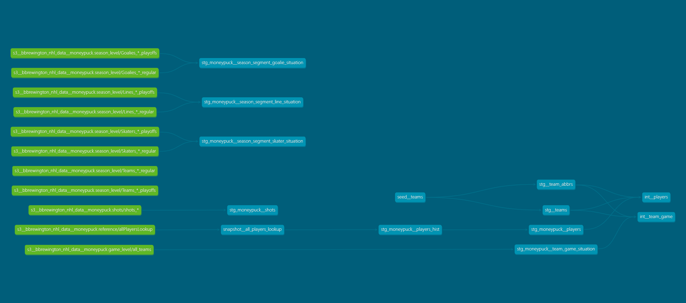

# NHL Data Project

A data engineering project for NHL hockey data analysis.

## Architecture

```text
NHL API / MoneyPuck.com
        │
        ▼
  ingestion/src/       ← Data ingestion (requests + backoff, BeautifulSoup)
  nhl_api/client.py    ← NHLClient with resource pattern (.league, .teams, .players, .games)
  moneypuck/           ← CSV scraper, converts to Parquet
        │
        ▼
  S3 (Parquet)         ← s3://bbrewington-nhl-data/moneypuck/
        │
        ▼
  dbt/ (dbt-duckdb)    ← SQL transformations against S3 sources
  staging/             ← stg_* models (materialized: table)
  intermediate/        ← int_* models (materialized: view)
  snapshots/           ← SCD Type 2 player tracking
        │
        ▼
  DuckDB / MotherDuck  ← Analytics queries
```



## Project Structure

- `ingestion/`: Data ingestion from NHL API and MoneyPuck
  - `src/`: Source packages (nhl_api, moneypuck, utility)
  - `scripts/`: Entry point scripts
- `dbt/`: dbt project for data transformation
- `data/`: Local data storage (git-ignored)

## Getting Started

1. Clone the repository
1. Set up Python environment (with uv):
    ```bash
    uv venv
    uv sync
    ```
1. Set up environment variables:
   1. Create .env file 
    ```bash
    cp .env.example .env
    ```
    1. Edit .env with your configuration
1. Run the data acquisition scripts:
    ```bash
    uv run python ingestion/scripts/nhl_api/get_nhl_api_data.py
    uv run python ingestion/scripts/get_moneypuck_data.py
    ```
1. Run dbt models:
    ```bash
    deactivate
    cd $(git rev-parse --show-toplevel)/dbt
    uv venv
    uv run dbt deps
    uv run dbt build
    ```

## Data Sources

### NHL API: Official NHL statistics API

### MoneyPuck.com: Advanced hockey statistics

## License

MIT
